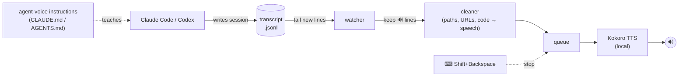

<div align="center">

# 🔊 Agent Voice

**Give life to your agents!**

Live narration, alerts and spoken work summaries from **Claude Code** and **Codex**,
with a neural voice that runs entirely on your machine.

[](LICENSE)


[](https://claude.com/claude-code)
[](https://github.com/openai/codex)

[Installation](#-installation) · [Usage](#-usage) · [Settings](#%EF%B8%8F-settings) · [How it works](#-how-it-works) · [Troubleshooting](#-troubleshooting)

</div>

---

## ✨ What it sounds like

You give the agent a task and look away. agent-voice talks you through it:

```text
🔊 Opening the shop file to look at the cart total and tax code.
🔊 Found three bugs: quantity is ignored, rounding drops cents, and tax divides by ten.

   ... edits, test runs and diffs scroll by on screen, unspoken ...

🔊 I fixed the cart total and the tax calculation. The total now multiplies each
   price by its quantity and keeps two decimal places, and the tax now treats
   eighteen as eighteen percent. My quick checks all passed. The tax result still
   isn't rounded, so tell me if you want it rounded to two decimals too.
```

Reading every message aloud would be noise, so **the agent decides what's worth
saying**. agent-voice teaches it three kinds of voice lines:

| | When | Sounds like |
|---|---|---|
| 🎙️ **Live narration** | starting a step, finding a cause, tests pass/fail | *"Found it, the button still calls the old endpoint."* |
| 🚨 **Alerts** | it needs your input or approval, or it's blocked | *"I need your approval before I delete the old migrations."* |
| 📋 **Work summary** | end of a task | what was done and why, how it was checked, what's left |

## 🚀 Features

<table>
<tr>
<td width="50%" valign="top">

**🧠 Agent-curated speech**<br>
The agent picks the moments; routine progress stays silent. Want less? `narration quiet`.
Want everything? `speak all`.

**🔒 Private and offline**<br>
[Kokoro-82M](https://huggingface.co/hexgrad/Kokoro-82M) runs on your CPU, about 3× faster than real time.
No API keys, no cloud, nothing leaves your machine.

**🗣️ Speech-friendly text**<br>
Code blocks are skipped. URLs become "a link", paths "a file path", and IPs, hashes
and UUIDs are named instead of spelled out.

</td>
<td width="50%" valign="top">

**🤝 Claude Code + Codex together**<br>
CLI, VS Code and desktop sessions, several at once. No hooks or plugins: it never
slows the agent down.

**⌨️ Stop it instantly**<br>
Press <kbd>Shift</kbd>+<kbd>Backspace</kbd> anywhere to cut off the current speech.
Any key combo you like.

**📦 One-line install**<br>
Sets up Python via pyenv, a private virtualenv, the voice model and autostart.
Nothing else on your system is touched.

</td>
</tr>
</table>

## 📥 Installation

Choose one of the two ways. Both end up with the same setup.

| | 🤖 **Option 1: Let your agents install itself** | 🛠️ **Option 2: Manual installation** |
|---|---|---|
| **You do** | Paste one prompt into Claude Code or Codex | Run one command in a terminal |
| **Best for** | Hands-off setup; the agent checks and fixes problems for you | Full control over every step |

---

### 🤖 Option 1: Let your agents install itself

Paste this into **Claude Code** or **Codex**:

```text
Install Agent Voice on this machine for me. Read the install guide at
https://raw.githubusercontent.com/Yugendiran/agent-voice/main/Install%20Guide.md
and follow it step by step.
```

The agent reads the [Install Guide](Install%20Guide.md), runs the installer for your OS,
checks that the voice works and fixes problems on the way. When it's done it asks you to
**restart your Claude Code / Codex sessions**, since the voice instructions are only read when
a session starts.

> [!IMPORTANT]
> The agent needs permission to run shell commands and to reach the internet. Codex's
> default sandbox blocks network access, so approve the installer when it asks.

---

### 🛠️ Option 2: Manual installation

**Windows** (PowerShell):

```powershell
irm https://raw.githubusercontent.com/Yugendiran/agent-voice/main/install.ps1 | iex
```

**macOS / Linux**:

```bash
curl -fsSL https://raw.githubusercontent.com/Yugendiran/agent-voice/main/install.sh | bash
```

Then **restart your Claude Code / Codex sessions**. That's it.

> [!TIP]
> Linux prerequisites, installing from a clone, what the installer changes, checking the
> install, fixes for common problems, updating and uninstalling are all in the
> 📖 **[Install Guide](Install%20Guide.md)**.

## 🎛 Usage

agent-voice runs in the background. These are the commands you'll use:

| Command | What it does |
|---|---|
| `agent-voice status` | Is it running, and with which settings? |
| `agent-voice start` · `stop` · `restart` | Control the background narrator |
| `agent-voice mute` · `unmute` · `toggle` | Silence it without stopping it |
| `agent-voice skip` | Cut off the current line (or press <kbd>Shift</kbd>+<kbd>Backspace</kbd>) |
| `agent-voice say "hello"` | Speak some text, handy for trying voices |
| `agent-voice voices` | List the available voices |
| `agent-voice config` | Show settings; `config KEY VALUE` changes one, live |
| `agent-voice instructions on\|off` | Add or remove the voice-line instructions for the agents |
| `agent-voice autostart on\|off` | Start at login, or don't |
| `agent-voice log` | Recent log lines, including everything spoken |
| `agent-voice run` | Run in the foreground with console logging |

## ⚙️ Settings

Change any setting with `agent-voice config KEY VALUE`. It applies immediately, with no restart.

| Key | Default | Description |
|---|---|---|
| `narration` | `live` | `live`: commentary + alerts + summary. `quiet`: alerts + summary only |
| `speak` | `marked` | `marked`: only the 🔊 lines the agent writes. `all`: every message in full |
| `voice` | `af_heart` | Kokoro voice, see below |
| `speed` | `1.1` | Speaking rate |
| `engine` | `kokoro` | `kokoro` (neural) or `system` (Windows SAPI / macOS `say` / espeak-ng, no download) |
| `mode` | `queue` | `queue`: lines play in order, stale backlog dropped. `interrupt`: new lines cut in |
| `hotkey` | `shift+backspace` | Global stop shortcut, e.g. `ctrl+alt+x`, `f9`; `off` disables it |
| `claude` / `codex` | `true` | Which agents to listen to |
| `final_only` | `false` | Only the last message of each turn |
| `max_chars` | `400` | With `speak all`, long messages are trimmed to their first sentences |
| `muted` | `false` | Same as `agent-voice mute` |

Settings are stored in `~/.agent-voice/config.json`.

### 🎤 Voices

```powershell
agent-voice voices                   # list them all
agent-voice config voice am_michael  # switch
agent-voice say "How do I sound?"    # try it
```

The first letter is the accent (`a` American, `b` British), the second the gender (`f` / `m`).
Good ones to start with: `af_heart`, `af_bella`, `am_michael`, `am_fenrir`, `bf_emma`, `bm_george`.

### ⌨️ Stop shortcut

Press the shortcut in any window to stop the speech playing right now; anything queued is
dropped too. It only acts while something is being spoken.

```powershell
agent-voice config hotkey ctrl+alt+x   # any combo
agent-voice config hotkey off          # disable
```

Key names: `ctrl`, `alt` (`option`), `shift`, `win` (`cmd`), letters, digits, `f1`–`f20`,
`space`, `backspace`, `esc`, `enter`, `tab` and so on, joined with `+`.

> [!NOTE]
> The key press still reaches the focused app. If <kbd>Shift</kbd>+<kbd>Backspace</kbd> deleting a
> character in your prompt bothers you, pick a combo that does nothing there, like `ctrl+alt+x`.

## 🔍 How it works



1. **Instructions.** A short section in the agents' global instruction files asks them to write
   🔊 lines for live narration, alerts and an end-of-task summary, in plain spoken English.
   The wording lives in [`instructions.py`](src/agent_voice/instructions.py).
2. **Transcripts.** Both agents already save every session as JSON lines. agent-voice tails
   only the files being written right now, and never reads out older history.

   | Agent | Transcript | Read from |
   |---|---|---|
   | Claude Code | `~/.claude/projects/<project>/<session>.jsonl` | assistant `text` blocks (not tool calls, thinking or subagents) |
   | Codex | `~/.codex/sessions/YYYY/MM/DD/rollout-*.jsonl` | assistant `message` items |

3. **Cleaning.** [`cleaner.py`](src/agent_voice/cleaner.py) turns screen text into something
   pleasant to hear.
4. **Speaking.** Kokoro synthesizes the next sentence while the current one plays, so speech
   starts within about half a second.

No hooks are involved, so the agent never waits on agent-voice. A localhost port (`47821`,
override with `AGENT_VOICE_PORT`) carries the `mute` / `stop` / … commands and keeps a single
copy running. `CLAUDE_CONFIG_DIR` and `CODEX_HOME` are respected.

## 🩺 Troubleshooting

<details>
<summary><b>I don't hear anything</b></summary>

1. `agent-voice status`: is it running and not muted?
2. `agent-voice say "test"`: if this is silent, check your audio output device and volume.
3. `agent-voice log`: every spoken line is logged as `speaking: …`.

</details>

<details>
<summary><b>The voice works, but my agent never speaks</b></summary>

- Instructions load when a session **starts**: open a new Claude Code / Codex session.
- `agent-voice instructions` shows whether they're installed; `agent-voice instructions on` adds them.
- To hear every message regardless, use `agent-voice config speak all`.

</details>

<details>
<summary><b>It talks too much or too little</b></summary>

- Too much: `agent-voice config narration quiet` keeps only alerts and the end-of-task summary.
- Too little: `agent-voice config narration live`, or `speak all` for everything.

</details>

<details>
<summary><b>The stop shortcut doesn't work</b></summary>

- **macOS**: allow your terminal (or Python) in *System Settings → Privacy & Security → Accessibility*.
- **Linux**: global shortcuts need X11; they are not available on Wayland. Use `agent-voice skip` instead.
- **Windows**: shortcuts aren't seen while an app running as administrator is focused.

</details>

<details>
<summary><b>The install failed</b></summary>

See [Step 3 of the Install Guide](Install%20Guide.md#step-3-if-something-failed) for fixes
by symptom (Linux build packages, PortAudio, execution policy, interrupted downloads, Codex sandbox).

</details>

## 🔐 Privacy

Everything runs locally. agent-voice only reads your own agent session files, makes no network
calls after installing, and sends nothing anywhere. The one thing it writes outside
`~/.agent-voice` is the marked *Voice updates* section in your agents' instruction files.

## 🗑 Uninstall

```powershell
irm https://raw.githubusercontent.com/Yugendiran/agent-voice/main/uninstall.ps1 | iex   # Windows
```

```bash
curl -fsSL https://raw.githubusercontent.com/Yugendiran/agent-voice/main/uninstall.sh | bash   # macOS / Linux
```

This stops agent-voice and removes it, its autostart entry, PATH entry and the agent
instructions. pyenv and its Python stay, since other projects may use them.

## 🛠 Development

```bash
git clone https://github.com/Yugendiran/agent-voice && cd agent-voice
~/.agent-voice/venv/Scripts/python -m pip install -e ".[dev]"   # bin/ instead of Scripts/ on macOS/Linux
~/.agent-voice/venv/Scripts/python -m pytest
agent-voice restart     # pick up your changes
agent-voice run         # or run in the foreground with logs
```

| Module | Role |
|---|---|
| [`sources.py`](src/agent_voice/sources.py) | Where each agent's transcripts live and how to parse them |
| [`watcher.py`](src/agent_voice/watcher.py) | Tails the active transcript files |
| [`instructions.py`](src/agent_voice/instructions.py) | The voice-line instructions and 🔊 extraction |
| [`cleaner.py`](src/agent_voice/cleaner.py) | Markdown → speakable text |
| [`tts.py`](src/agent_voice/tts.py) · [`speaker.py`](src/agent_voice/speaker.py) | Voices and the playback queue |
| [`daemon.py`](src/agent_voice/daemon.py) · [`cli.py`](src/agent_voice/cli.py) | Background process and commands |

## 🙏 Credits

[Kokoro-82M](https://huggingface.co/hexgrad/Kokoro-82M) by hexgrad ·
[kokoro-onnx](https://github.com/thewh1teagle/kokoro-onnx) ·
[pynput](https://github.com/moses-palmer/pynput) ·
[pyenv](https://github.com/pyenv/pyenv) / [pyenv-win](https://github.com/pyenv-win/pyenv-win)

## 📄 License

[MIT](LICENSE)
